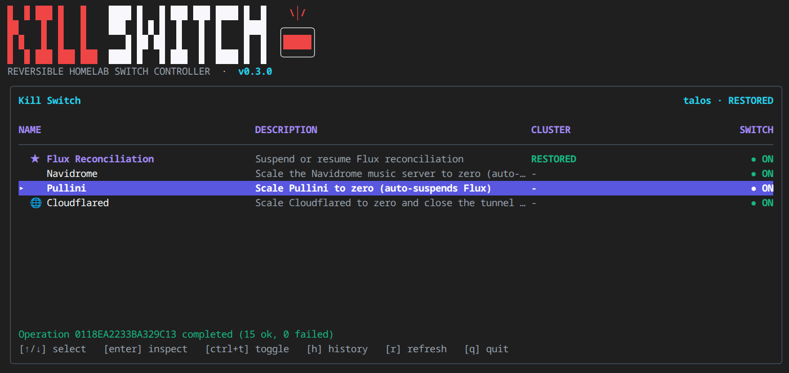

<p align="center">
  
</p>

<h1 align="center">Kill Switch</h1>

<p align="center"><b>Reversible infrastructure operations for Kubernetes homelabs.</b></p>

<p align="center">
  
  
  
  
  
</p>

<p align="center">
  
</p>

**Kill Switch** (`killswitch`) is a single-binary, reversible infrastructure operations controller for Kubernetes and homelab clusters.

Phases 1–2 implement a **Level 2 Flux Freeze**: suspending and restoring configured Flux `Kustomization` and `HelmRelease` resources with strict dependency ordering, write-ahead JSON journaling, atomic crash recovery, and both CLI and interactive TUI interfaces.

Phase 3 adds layered `switches.yaml` + `workflows/*.yaml` configuration, a Go action-handler registry (`flux.suspend`/`flux.resume`, `kubernetes.scale`, optional `kubernetes.suspend`), typed journal v2 originals, and a Flux dependency interlock that suspends reconciliation before scaling a dependent down.

One-way switches (`one_way: true`) are buttons: they run their steps once, in declaration order, with no ON side. `talos.shutdown` uses `talosctl` to power off nodes sequentially.

Operation history records per-step values in the CLI (`--details`) and the TUI (`Enter`, then `l` for raw journal records), and status isolates a failed probe to its own switch instead of failing the whole report.

---

## Table of Contents

- [Features](#features)
- [Tech Stack](#tech-stack)
- [Installation & Build](#installation--build)
- [Configuration](#configuration)
- [Commands & Usage](#commands--usage)
  - [`killswitch status`](#killswitch-status)
  - [`killswitch <switch-id> on|off`](#killswitch-switch-id-onoff)
  - [`killswitch suspend`](#killswitch-suspend)
  - [`killswitch restore`](#killswitch-restore)
  - [`killswitch history`](#killswitch-history)
  - [`killswitch tui`](#killswitch-tui)
- [Global Flags](#global-flags)
- [Exit Codes](#exit-codes)
- [Safety & Architecture](#safety--architecture)
  - [Workflow Ordering](#workflow-ordering)
  - [Action Handlers](#action-handlers)
  - [Write-Ahead Log (`journal.jsonl`)](#write-ahead-log-journaljsonl)
  - [Atomic State Snapshot (`state.json`)](#atomic-state-snapshot-statejson)
  - [Conflict Detection & `--force`](#conflict-detection---force)
  - [Interrupted Run Recovery](#interrupted-run-recovery)
- [RBAC & Permissions](#rbac--permissions)

---

## Features

- **Reversible by design**: Captures the exact original state before changing anything and restores only to that original baseline. One-way buttons (`one_way: true`) are the explicit, irreversible exception.
- **Strict Dependency Ordering**:
  - **Suspend**: Freezes Kustomizations first (reverse order), then HelmReleases (reverse order).
  - **Restore**: Unfreezes HelmReleases first (forward order), then Kustomizations (forward order), preventing health-check hangs on suspended Helm releases.
- **Crash Proof**: Every intent is recorded to a write-ahead log (`journal.jsonl`) and synced (`fsync`) before any Kubernetes API patch is executed.
- **Concurrency Protection**: Non-blocking `flock` prevents concurrent executions across separate terminals or scripts.
- **Conflict Aware**: Detects out-of-band cluster modifications in either direction and refuses to overwrite without `--force`.
- **History Everywhere**: `killswitch history --details` and the TUI `h` view read the same journal, with per-step values and raw journal records.
- **Resilient Status**: A failed live probe is reported as `UNKNOWN`/`⚠ ERROR` on that switch while the rest of the report still renders.
- **Precise Recovery**: An interrupted operation resumes or undoes only the resources it actually touched.
- **Zero Flux Go Dependencies**: Built directly on `k8s.io/client-go/dynamic` and discovery APIs.

---

## Tech Stack

| Layer | Technology |
| --- | --- |
| Language | Go 1.27 |
| Cluster access | `k8s.io/client-go` dynamic + discovery APIs |
| Flux resources | `kustomize.toolkit.fluxcd.io` and `helm.toolkit.fluxcd.io` via unstructured objects |
| Configuration | Layered YAML — `switches.yaml` + `workflows/*.yaml` |
| TUI | Bubble Tea + Lip Gloss |
| Safety | Append-only JSONL write-ahead journal, atomic `state.json` snapshot, and `flock` locking |
| Testing | Go `testing` with client-go fake dynamic clients and an injectable Talos probe |

---

## Installation & Build

### Prerequisites

- Go `1.27+` (or distro package)
- Active `kubeconfig` pointing to your cluster
- Optional: `talosctl` on `PATH` with a working `~/.talos/config` for `talos.shutdown` workflows

### Build Binary

```bash
# Build the single binary
go build -o killswitch ./cmd/killswitch

# Verify
./killswitch --help
```

---

## Configuration

Kill Switch searches for configuration in the following order:
1. `--config <path>` flag (a directory or a switches YAML file)
2. `./switches.yaml`
3. `./switches.yml`
4. `./config.yaml`
5. `./config.yml`
6. `./config.example.yaml`
7. `~/.config/killswitch/`

Configuration is layered: `switches.yaml` plus one YAML file per workflow in `workflows/` next to it. Legacy single-file `flux.resources` configs are rejected.

```
config/
├── switches.yaml
└── workflows/
    ├── flux.yaml
    ├── navidrome.yaml
    ├── pullini.yaml
    ├── cloudflared.yaml
    └── cluster-shutdown.yaml
```

### Example Configuration

`config.example.yaml`:

```yaml
switches:
  - id: flux
    name: Flux Reconciliation
    description: Suspend or resume Flux reconciliation
    icon: ⭐
    workflow: flux

  - id: navidrome
    name: Navidrome
    description: Scale the Navidrome music server to zero (auto-suspends Flux)
    workflow: navidrome

  - id: pullini
    name: Pullini
    description: Scale Pullini to zero (auto-suspends Flux)
    workflow: pullini

  - id: cloudflared
    name: Cloudflared
    description: Scale Cloudflared to zero and close the tunnel (auto-suspends Flux)
    icon: 🌐
    workflow: cloudflared

  - id: cluster-shutdown
    name: Cluster Shutdown
    description: Power off 235 → 234 → 233 (one-way; no automatic restore)
    icon: 🛑
    workflow: cluster-shutdown
```

`icon` is optional. It is rendered in a fixed-width slot in the TUI so names stay aligned; switches without an icon simply leave that slot blank.

`workflows/navidrome.yaml`:

```yaml
id: navidrome
name: Navidrome
requires:
  flux: suspended

steps:
  - id: navidrome
    action: kubernetes.scale
    target: {kind: Deployment, namespace: navidrome, name: navidrome}
    states:
      off: {replicas: 0}
      on: {restore: previous, default: 1}
```

`workflows/pullini.yaml` and `workflows/cloudflared.yaml` follow the same pattern. See `workflows/flux.yaml` for the full Flux example. Steps run in order for ON and in reverse order for OFF; one-way workflows run in declaration order.

```yaml
# workflows/cluster-shutdown.yaml
id: cluster-shutdown
one_way: true
timeout: 10m
steps:
  - {id: 01-235, action: talos.shutdown, target: {kind: Node, name: "192.168.2.235"}}
  - {id: 02-234, action: talos.shutdown, target: {kind: Node, name: "192.168.2.234"}}
  - {id: 03-233, action: talos.shutdown, target: {kind: Node, name: "192.168.2.233"}}
```

A one-way switch has no ON side: it is a button that runs each step once and waits for the node to become unreachable before starting the next. `talos.shutdown` requires `talosctl` on `PATH` with a working `~/.talos/config`, and must be run from outside the nodes being shut down. Each step waits up to the workflow `timeout` (default `90s`; set `timeout: 10m` when nodes take several minutes to power off), and an individual step can override it. The CLI automatically extends its default operation timeout for one-way workflows to cover every step; if you pass `--timeout` explicitly it must cover the whole run. A probe failure renders that switch as `⚠ ERROR`/`UNKNOWN` instead of aborting the whole status report.

Supported actions:

| Action | Targets | Captured original |
|---|---|---|
| `flux.suspend` / `flux.resume` | Flux `Kustomization`, `HelmRelease` | `spec.suspend` |
| `kubernetes.scale` | `Deployment`, `StatefulSet` | `spec.replicas` |
| `kubernetes.suspend` (optional) | `CronJob` | `spec.suspend` |
| `talos.shutdown` | `Node` (address in `name`) | reachability (`up`/`down`); irreversible |

Validate without a cluster:

```bash
./killswitch validate --config config.example.yaml
```

---

## Commands & Usage

### `killswitch status`

Displays the live status of every switch and, for the Flux switch, the configured resources.

```bash
# Human-readable tables
./killswitch status

# One switch only
./killswitch status --switch navidrome

# Machine-readable JSON output
./killswitch status --json
```

Output highlights:
- `STATUS`: `ACTIVE` (reconciling), `SUSPENDED` (frozen), or `MISSING`
- `ORIGINAL`: Recorded original state before the last suspend
- `GEN/OBS`: Resource generation vs observed generation (tagged with `(!)` if the controller is lagging)
- `PHASE`: Active in-progress phase during an operation or recovery

A switch whose live probe fails is reported with `Error:`/`UNKNOWN` (or `⚠ ERROR` in the TUI) without hiding the other switches. For one-way buttons, the switch state reads `▶ SHUTDOWN` (targets up), `○ DOWN` (all off), or `◐ PARTIAL`.

---

### `killswitch <switch-id> on|off`

Turns any configured switch ON or OFF. OFF captures originals and applies the non-default state; ON restores the captured originals (or the configured fixed/default state).

```bash
./killswitch navidrome off --dry-run
./killswitch navidrome off --yes
./killswitch navidrome on --yes
```

One-way switches are buttons: `off` runs them once in declaration order and `on` is refused.

```bash
./killswitch cluster-shutdown off --yes
```

`killswitch suspend` and `killswitch restore` remain aliases for `flux off` and `flux on`.

### `killswitch suspend`

Freezes all configured Flux resources by setting `spec.suspend: true`.

```bash
# 1. Preview changes without modifying the cluster
./killswitch suspend --dry-run

# 2. Interactive execution (prompts for confirmation)
./killswitch suspend

# 3. Non-interactive execution (e.g. in CI or scripts)
./killswitch suspend --yes

# 4. Override external conflict warnings
./killswitch suspend --force
```

---

### `killswitch restore`

Restores all configured resources to their recorded original states.

```bash
# 1. Preview restore plan
./killswitch restore --dry-run

# 2. Execute restore with confirmation
./killswitch restore

# 3. Non-interactive restore
./killswitch restore --yes

# 4. Override external modifications
./killswitch restore --force
```

---

### `killswitch history`

Inspects past operations recorded in the write-ahead journal (`journal.jsonl`). Each row shows when the switch ran, its name, direction (`ON`, `OFF`, or `ONE-WAY`), result, completed/target steps, and duration.

```bash
# Show last 10 operations
./killswitch history --limit 10

# Filter by switch
./killswitch history --switch navidrome --limit 10

# Expand every operation into its workflow steps, targets, and errors
./killswitch history --limit 10 --details

# Output full history as JSON (includes per-step records)
./killswitch history --json
```

---

### `killswitch tui`

Launches the full interactive terminal UI powered by Bubble Tea:

```bash
./killswitch tui
```

The main screen is a k9s-style table loaded from `switches.yaml`. The Flux reconciliation switch is the main control: it is always pinned to the top (even if declared later in the file) and rendered in the accent color. Switches may set an optional `icon` (for example `⭐` for Flux or `☁` for a tunnel switch); icons render in a fixed-width slot so names stay aligned, and unset icons leave that slot blank.

Each panel title is a breadcrumb of your current location, e.g. `Flux Controls › Flux Reconciliation › Properties`, so you always know which level of the UI you are in.

The `STATE` column is the live position of each switch (`● ON`, `○ OFF`, `◐ MIXED`, `⚠ DRIFT`, `✕ MISSING`, `? UNKNOWN`) derived from observing every step. One-way switches render as buttons (`▶ SHUTDOWN`, `○ DOWN`, `◐ PARTIAL`), and a failed probe renders `⚠ ERROR`. For the Flux switch, the `CLUSTER` column additionally shows the aggregate (`RESTORED`, `SUSPENDED`, `MIXED`, `DRIFT`, `MISSING`). The properties view lists workflow steps with their observed and original values, and shows a probe error banner when the switch cannot be observed.

**Keybindings:**
- `↑` / `↓` (or `k` / `j`) — Select a switch (or scroll resources, the YAML view, operations in history, and history details)
- `Enter` — Open the selected switch's properties and list all Flux resources; in history, open the selected operation's per-step details
- `y` (in properties) — Show the selected switch's effective YAML; scroll with `↑`/`↓`, `g`/`G`, or `PgUp`/`PgDn`, `Esc` to go back
- `Esc` — Return from the properties, YAML, history details, or history view to the previous screen
- `Ctrl+T` (or `t` / `Space`) — Toggle the selected switch (or run a one-way button); a "building switch plan" dialog appears immediately, then the confirmation dialog once the plan is ready
- `h` — Open the operation history recorded in `journal.jsonl`; `Enter` expands the selected operation into its steps
- `l` (in history or history details) — Show the raw journal records for the selected operation; scroll with `↑`/`↓`, `g`/`G`, or `PgUp`/`PgDn`
- `y` / `Enter` (in the confirmation dialog) — Confirm the pending change
- `f` — Confirm with force override when the plan shows conflicts
- `n` / `Esc` — Cancel the pending change
- `r` / `u` — Refresh live cluster status (and history)
- `q` / `Ctrl+C` — Exit TUI

> `Ctrl+Enter` is not distinguishable from plain `Enter` in Bubble Tea, so `Ctrl+T` is used for toggling.

---

## Global Flags

The following flags apply to all subcommands:

| Flag | Default | Description |
|---|---|---|
| `--config <path>` | `switches.yaml` | Path to the config directory or switches YAML file |
| `--context <name>` | Current context | Target Kubernetes context |
| `--kubeconfig <path>` | `~/.kube/config` | Path to kubeconfig file |
| `--timeout <duration>` | `60s` | Operation timeout; auto-extended for one-way shutdown workflows (an explicit value overrides) |
| `--state-dir <path>` | `$XDG_STATE_HOME/killswitch` | Directory for the journal, `state.json`, and lock file |
| `--log-level <level>` | `info` | Log verbosity: `debug`, `info`, `warn`, `error` |

---

## Exit Codes

Kill Switch follows strict exit code semantics for reliable automation:

| Code | Meaning | Cause |
|---|---|---|
| `0` | Success | Operation completed and verified |
| `1` | Partial failure | One or more workflow steps failed patching or read-back verification |
| `2` | Config / Connection error | Invalid YAML, unreachable cluster, or missing target resource |
| `3` | Conflict | Resource was modified outside Kill Switch; requires `--force` |
| `4` | Unsafe state / Lock contention | Concurrent run active or incomplete state without recorded originals |

---

## Safety & Architecture

### Workflow Ordering

Workflow steps run in declaration order for ON and in reverse order for OFF. The example Flux workflow declares HelmReleases forward then Kustomizations forward, so OFF runs Kustomizations in reverse and then HelmReleases in reverse, and ON restores HelmReleases before Kustomizations. This prevents Kustomizations with `wait: true` from timing out on suspended Helm releases.

One-way workflows (`one_way: true`) ignore the ON direction entirely and always run in declaration order, waiting for each sequential shutdown to finish before starting the next. Set a workflow-level `timeout` (or a per-step `timeout`) when targets take longer than the 90s default to power off. They cannot declare `requires.flux`.

A workflow may declare `requires: {flux: suspended}` or `{flux: active}`. Turning a dependent OFF (capturing originals and applying its non-default state) auto-toggles Flux to the required state first, so scaling a Flux-managed workload down is not immediately reconciled back. Turning the dependent back ON leaves Flux as-is. Toggling Flux never touches dependent switches; Flux reconciliation remains the source of truth for workloads. The whole prerequisite cascade is journaled as one operation.

### Action Handlers

Every step is executed by a Go handler implementing `Validate → Observe → Capture → Desired → Apply → Restore`; the engine performs planning and read-back verification around those calls. Originals are typed per action: bool for suspend flags, int for replicas, and string (`up`/`down`) for node reachability. They are stored in journal v2 events (`switch`, `workflow`, `step`, `direction`, `original`, `desired`, `observed`, `phase`). v1 journals still replay.

### Write-Ahead Log (`journal.jsonl`)

Located at `$XDG_STATE_HOME/killswitch/journal.jsonl` (fallback `~/.local/state/killswitch/journal.jsonl`):
- Mode `0600` on disk.
- Events: `op.start`, `resource.intent`, `resource.result`, `conflict`, `op.end`.
- An intent is **appended and fsynced before** the cluster patch is sent.
- Crashes mid-line produce torn writes, which the parser automatically detects and ignores.

### Atomic State Snapshot (`state.json`)

Derived view of the active operation and recorded original states:
- Written to a temporary file, fsynced, atomically renamed over `state.json`, followed by directory fsync.
- If `state.json` is missing or out of sync with `journal.jsonl`, it is automatically reconstructed by replaying the journal.

### Conflict Detection & `--force`

If a resource's observed state on the cluster no longer matches what Kill Switch expects (suspension flag, replicas, or node reachability; e.g. manually edited via `kubectl` or another operator, in either direction):
- Kill Switch flags this as a `conflict` and journals the expected and observed values.
- Execution halts with **Exit Code 3**.
- Use `--force`, or `f` in the TUI confirmation dialog, to acknowledge and proceed.

### Interrupted Run Recovery

If the tool is terminated (e.g. `SIGKILL`, system reboot, power cut):
1. `killswitch status` flags the interrupted operation and its per-resource phases.
2. Running `killswitch suspend` completes only the targets the interrupted operation had not verified.
3. Running `killswitch restore` undoes only the targets the interrupted operation actually touched.

Resources outside the interrupted operation are never re-planned or overwritten by recovery.

For one-way workflows, rerunning the button only completes the steps that were not already verified. There is no restore path for a shut-down node.

---

## RBAC & Permissions

For cluster environments requiring least-privilege service accounts, apply `rbac.example.yaml`:

```yaml
apiVersion: rbac.authorization.k8s.io/v1
kind: ClusterRole
metadata:
  name: killswitch-flux-freeze
rules:
  - apiGroups: ["kustomize.toolkit.fluxcd.io"]
    resources: ["kustomizations"]
    verbs: ["get", "list", "patch"]
  - apiGroups: ["helm.toolkit.fluxcd.io"]
    resources: ["helmreleases"]
    verbs: ["get", "list", "patch"]
  - apiGroups: ["apps"]
    resources: ["deployments", "statefulsets"]
    verbs: ["get", "list", "patch"]
  - apiGroups: ["batch"]
    resources: ["cronjobs"]
    verbs: ["get", "list", "patch"]
```

Apply with:
```bash
kubectl apply -f rbac.example.yaml
```

`talos.shutdown` shells out to `talosctl` and is not governed by these Kubernetes permissions.
